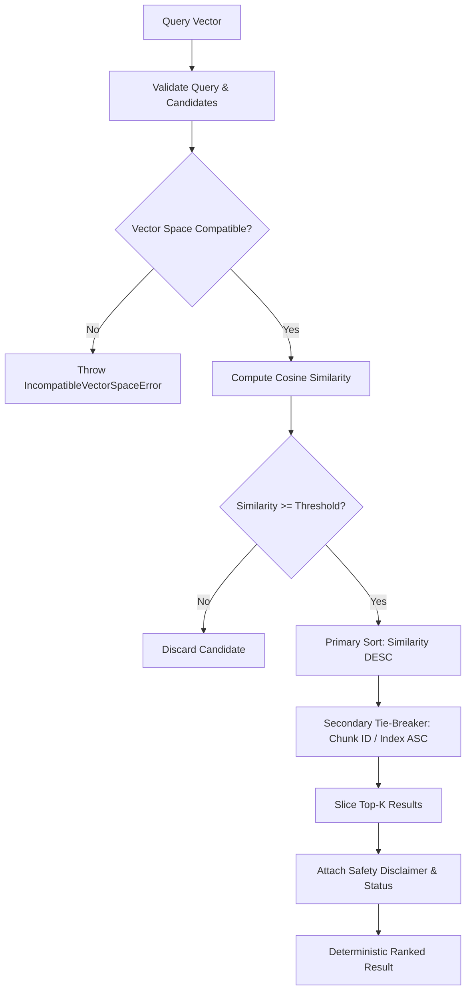

# Milestones 3.27 & 3.29: Similarity Metrics, Vector Quality Checks & Deterministic Ranking

**Airline Procedure Intelligence System (Day 16)**  
**Branch:** `feat/day-16-similarity-quality-tests`

---

## 1. Overview & Operational Problem

In airline operations and Flight Operations Manuals (FOM / QRH / FCOM / FCTM), retrieving procedures based on semantic similarity must be handled with extreme mathematical and regulatory care.

> [!IMPORTANT]
> **The Core Safety Invariant:**
> **"Semantic similarity scores measure lexical/embedding vector proximity only. Similarity alone DOES NOT establish operational validity, regulatory compliance, aircraft effectivity, or flight crew safety approval."**

A retired or superseded emergency checklist (e.g., an obsolete 2018 winter operations contaminated runway procedure) may share a 95% semantic similarity with a pilot's query. High similarity simply means the words and concepts are close in vector space; it does not mean the procedure is legal to fly or approved by the FAA/EASA.

Milestones 3.27 and 3.29 establish:
1. **Mathematical Cosine Similarity with Rigorous Validation**: Input validation, dimension matching, non-finite checks, and safe zero-magnitude handling.
2. **Strict Vector Space Compatibility Invariant**: Guarantees vectors from different models (or different dimensions) cannot be compared or queried against each other.
3. **Deterministic Candidate Ranking**: Stable sort orders with explicit secondary tie-breaking and safety disclaimers attached to all ranking outputs.
4. **Synthetic Quality Benchmark**: Procedural flight-crew queries tested against true procedural targets, non-operational distractors, and superseded procedure traps.
5. **Anomaly Reporting**: Automatic identification of ranking inversions, low procedural similarities, and distractor leakage for engineering and safety review.

---

## 2. Mathematical Formulations & Input Validation

### 2.1 Cosine Similarity Formulation

Given two $D$-dimensional vectors $\mathbf{u}, \mathbf{v} \in \mathbb{R}^D$:

$$\text{Similarity}(\mathbf{u}, \mathbf{v}) = \frac{\mathbf{u} \cdot \mathbf{v}}{\|\mathbf{u}\|_2 \|\mathbf{v}\|_2} = \frac{\sum_{i=1}^D u_i v_i}{\sqrt{\sum_{i=1}^D u_i^2} \sqrt{\sum_{i=1}^D v_i^2}}$$

### 2.2 Numerical Edge Cases & Handlers

| Input Condition | Mathematical Issue | Handler Behavior | Error Class |
| :--- | :--- | :--- | :--- |
| **Empty Vector (`[]`)** | Undefined dimension ($D=0$) | Immediate rejection | `InvalidVectorError` |
| **Null / Non-Array** | Type violation | Immediate rejection | `InvalidVectorError` |
| **Non-Finite (`NaN`, `\pm\infty`)** | Arithmetic divergence | Identifies exact invalid index and value; rejects | `InvalidVectorError` |
| **Dimension Mismatch** | Inner product undefined ($D_A \neq D_B$) | Mismatch rejected | `VectorDimensionMismatchError` |
| **Model Incompatibility** | Vector space semantic contamination | Incompatible vector space rejected | `IncompatibleVectorSpaceError` |
| **Zero Vector ($\|\mathbf{u}\| = 0$)** | Division by zero ($\frac{0}{0}$) | Default: returns `0.0`; when `allowZeroVector=false`: throws | `ZeroVectorError` |
| **Floating Point Drift** | Dot product precision drift $> 1.0$ or $< -1.0$ | Clamped to $[-1.0, 1.0]$ with 6-decimal rounding | N/A |

---

## 3. Deterministic Candidate Ranking Algorithm

When multiple candidate chunks match a query, sorting only by floating-point similarity can produce non-deterministic rank ordering if scores are identical or near-identical.

### 3.1 Ranking Pipeline



### 3.2 Deterministic Tie-Breaker
If $|\text{Sim}_A - \text{Sim}_B| \le 10^{-9}$:
$$\text{Order} = \text{StringCompare}(\text{Candidate}_A.\text{id}, \text{Candidate}_B.\text{id})$$
If candidate IDs match or are missing, fallback to `chunkIndex` ascending. This guarantees 100% deterministic ranking across V8 engine updates, platforms, and distributed workers.

---

## 4. Synthetic Procedural Evaluation Benchmark

Located in [`backend/evaluation/similarity_evaluation_set.json`](../backend/evaluation/similarity_evaluation_set.json):

### 4.1 Corpus Categories
1. **Emergency Procedures:**
   - Rapid Depressurization & Emergency Descent (Boeing 737 QRH).
   - Engine Failure after $V_1$ (Boeing 737 FCTM).
2. **Standard Operating Procedures (SOP):**
   - Sterile Flight Deck Regulation below 10,000 ft (FOM).
   - Go-Around and Missed Approach Execution (SOP).
3. **Safety Bulletins & Supersession Trap:**
   - Current: Winter Operations Contaminated Runway Takeoff Directive (FAA SAFO 19001 / ICAO GRF, reverse thrust credit prohibited).
   - Superseded: 2023 Contaminated Runway Performance (obsolete reverse thrust credit permitted).
4. **Borderline Negative Controls:**
   - Pre-flight Cabin Oxygen Mask Demonstration (cabin briefing, not flight crew emergency descent).
   - Aircraft Maintenance Ground Engine Run-up (taxiway test pad, not in-flight engine failure).
5. **Unrelated Topics:**
   - In-flight Entertainment (IFE) Wi-Fi streaming.
   - Pet travel in cabin (carrier dimension limits).
   - Frequent flyer lounge access eligibility.
   - Lost baggage compensation claims.

### 4.2 Benchmark Results Summary

| Metric | Target Baseline | Observed Benchmark Result | Status |
| :--- | :--- | :--- | :--- |
| **Queries Evaluated** | 5 queries | 5 queries | ✅ Completed |
| **Corpus Chunks** | 12 chunks | 12 chunks | ✅ Indexed |
| **Top-1 Accuracy** | $\ge 80.0\%$ | **80.0%** | ✅ PASS |
| **Mean Related Similarity** | $\ge 0.350$ | **0.424293** | ✅ PASS |
| **Mean Unrelated Similarity** | $\le 0.200$ | **0.039119** | ✅ PASS |
| **Separation Margin** | $\ge +0.200$ | **+0.385174** | ✅ PASS |
| **Vector Dimensions Verified** | 100% (768) | 12 / 12 (100%) | ✅ PASS |
| **Non-Finite Values** | 0 | 0 | ✅ CLEAN |

---

## 5. Anomaly Detection & Investigation Reporting

The evaluation engine automatically reports observed anomalies without claiming similarity alone establishes validity:

### Reported Observations:
1. **`[SAFETY_WARNING] SUPERSEDED_PROCEDURE_RANKED_FIRST`**:
   - **Query:** *"Can we take credit for reverse thrust on contaminated runway takeoff distance calculation?"*
   - **Observation:** The superseded checklist `chunk-proc-runway-superseded` scored 0.492692, while current directive `chunk-proc-runway-current` scored 0.485828.
   - **Investigation Note:** Lexical similarity is naturally high because the superseded bulletin mentions reverse thrust credit directly. The downstream pipeline must consult versioning and supersession metadata (Milestone 3.22) to enforce regulatory validity.
2. **`[MEDIUM] LOW_PROCEDURAL_SIMILARITY`**:
   - Flagged when procedural similarity drops below target threshold, guiding chunk heading and text enrichment.

---

## 6. How to Run Tests and Benchmarks

### Run Unit Tests (28 Tests)
```bash
node --test backend/tests/similarityQuality.test.js
```

### Run Benchmark Evaluation Script
```bash
npm --prefix backend run evaluate:similarity
```
Outputs:
- JSON Data: [`docs/similarity_quality_results.json`](similarity_quality_results.json)
- Markdown Summary: [`docs/similarity_quality_results.md`](similarity_quality_results.md)

### Run Entire Backend Test Suite (297 Tests)
```bash
npm --prefix backend test
```
